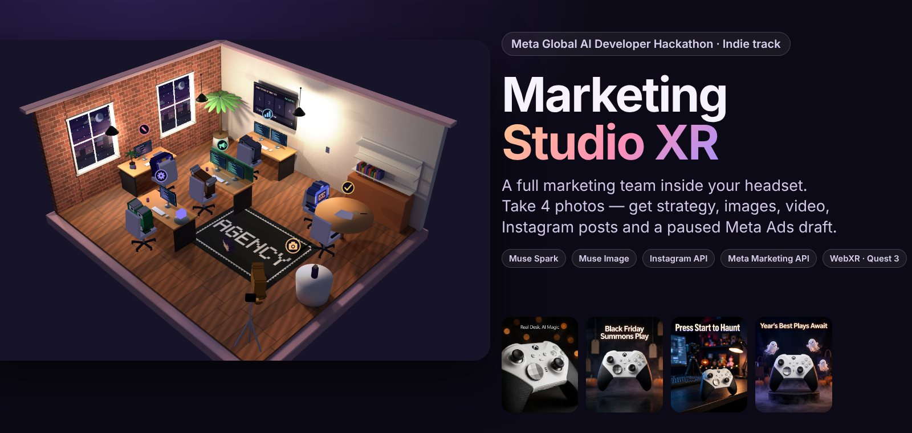
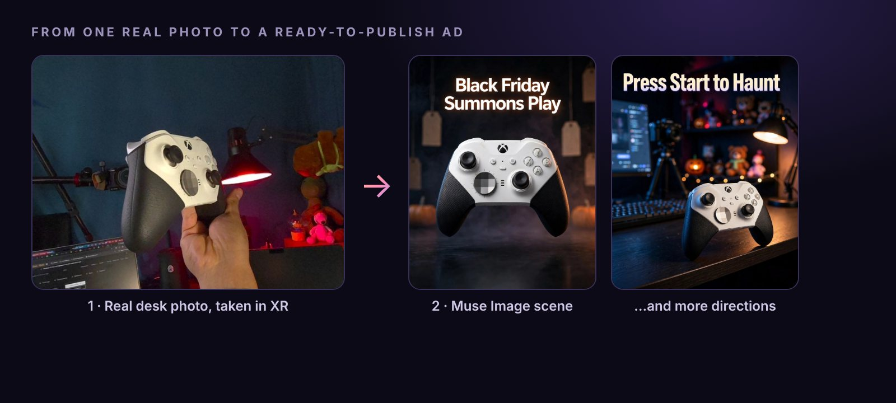
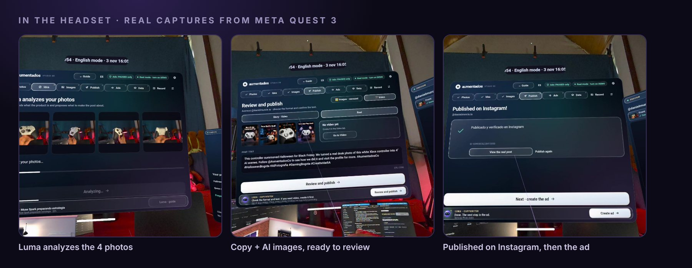
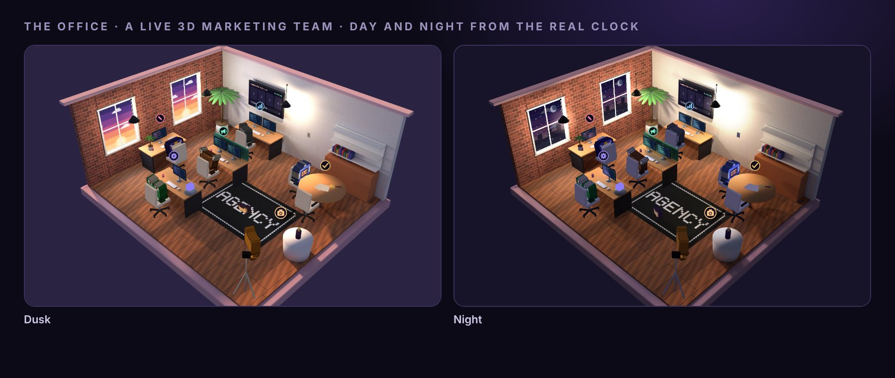
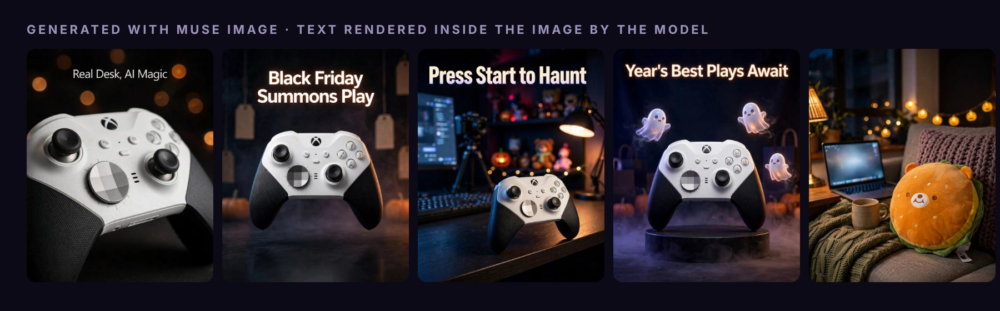

# Marketing Studio XR

**A mixed-reality marketing studio for Meta Quest 3. A small-business owner walks around a 3D office and builds a complete Instagram campaign — strategy, copy, images, a 9:16 video and a paused Meta Ads draft — guided by an AI assistant powered by Meta's Muse Spark.**

Built for the **Meta Global AI Developer Hackathon** · Indie Developer track · theme *Build for Your World* · by Daniel Murcia ([Aumentados](https://instagram.com/danielmurcia.ia), Colombia).

> WebXR + Three.js, a small Node.js server, no Unity, no build step. The headset opens a URL; everything else runs from this repository.

---

## Why

Small businesses in Latin America rarely have a marketing agency. They have a phone, a product and a few hours. Marketing Studio XR puts a whole agency workflow inside a headset: photograph the product, talk to the assistant (Luma), pick a direction, get images and a short vertical video, and prepare the ad — with hard guardrails so nothing is published or spent by accident.

## From one real photo to an ad



## In the headset

Real captures from a Meta Quest 3 session:



## The office

The 3D agency is a live scene: animated team members, screens showing work in progress, and a day/night cycle that follows the real clock.



## Generated with Muse Image



## What it does

| Step | What happens | Models / APIs |
|---|---|---|
| **Strategy** | Luma reads the product and market and proposes audience, theme and angle, grounded with web search | **Muse Spark 1.3** (Meta Model API) |
| **Photos** | Four guided product photos captured in XR (front, right, left, back) with a quality check | on-device |
| **Direction & Images** | Creative direction and campaign images from the product photos | **Muse Spark 1.3**, **Muse Image 1.0** |
| **Video** | A cinematic shot list (cuts every 2–3 s, one motivated camera move per shot, motivated light, audio layers) then a 9:16 clip | **Muse Spark 1.3** (director), Seedance 2.5 via fal.ai *(not a Meta model)* |
| **Ads draft** | Audience, placements, budget and copy prepared; campaign, ad set, creative and ad created in Meta Ads Manager **PAUSED** | Meta Marketing API |
| **Publish** | Optional Instagram publishing after an explicit confirmation | Instagram Graph API |

Everything user-facing works in **Spanish and English**: an `ES/EN` button in the header (or `?lang=en`) switches the whole interface, and Muse Spark is asked to answer in the selected language.

## Guardrails (by design)

- Ads are created **PAUSED only**; a guardian rejects any write that could activate or spend.
- A **hard spend cap** and a local ledger track every draft.
- Paid or write operations are off unless explicitly enabled in `.env` (`ENABLE_PAID_APIS`, `ENABLE_META_ADS_WRITE`).
- The ad account currency is read from Meta and enforced, so a mismatched budget is corrected before anything is sent.
- Secrets live only in the server's `.env`; the client never sees a key.

## Architecture

```
Quest 3 browser (WebXR, Three.js r180)
  └─ Canvas 2D panels used as 3D textures + DOM fallback/accessibility layer
        │  HTTPS (Cloudflare tunnel or local network)
Node.js server (server.mjs, no dependencies)
  ├─ lib/providers.mjs     Meta Model API: Muse Spark, Muse Image
  ├─ lib/strategy.mjs      market/audience strategy
  ├─ lib/video-director.mjs  shot-list planner and validator
  ├─ lib/fal.mjs           Seedance prompt builder / client
  ├─ lib/ads-planner.mjs   ad plan from images/video + copy
  ├─ lib/ads.mjs           Meta Marketing API adapter + spend guardian
  ├─ lib/ads-export.mjs    Ads Manager CSV export
  └─ agent/                Luma roles and skills
```

## Run it

Requires Node.js 22+. No `npm install` needed.

```bash
cp .env.example .env      # add your own keys; see comments inside
npm start                 # http://localhost:8844
npm test                  # unit tests use mocks; no paid calls
```

With no keys the app runs in **demo mode** (local, simulated results). For Quest you need a public HTTPS URL (for example a Cloudflare quick tunnel) set as `PUBLIC_BASE_URL`; open it in the headset browser.

## Tests

`npm test` runs ~76 tests covering the video director, ad guardian and planner, provider adapters, UI flow, the English/Spanish layer and the XR hit-testing. External APIs are mocked.

## Vision: one pipeline, many devices

This version runs as a WebXR app on Meta Quest 3/3S, built to push the programming to the limit. The same pipeline (photos, Muse Spark, Muse Image, video, Meta platform APIs) can be brought to Meta glasses with a display and to a phone version; only the way the photo is taken and the step-by-step flow change. In the future we will all have this capability on lighter, more portable glasses, with the same technology.

## Honest status

- Muse Spark text/vision, Muse Image, Instagram publishing and the Meta Marketing API ad-draft flow (budget, dates, audience, distance, objective; image and video creatives, always PAUSED) run against the real services from the headset. We are still polishing small details of the ad-draft step.
- Video generation uses Seedance 2.5 through fal.ai because no Meta video model was available to us; the shot-list planning is done by Muse Spark. Video is also by far the most expensive step to generate with AI, so it is optional and guarded by the paid-API switch.
- Full hand-tracking comfort in the headset is still being tuned.

## Notice

Any third-party characters, brands or products that appear in the demo video (for example a plush game character or a fantasy creature used as test subjects) are fan-made demonstrations for educational purposes only. They belong to their respective owners, and this project is not affiliated with or endorsed by them. No such characters are included in this repository.

## License

MIT — see [LICENSE](LICENSE).
